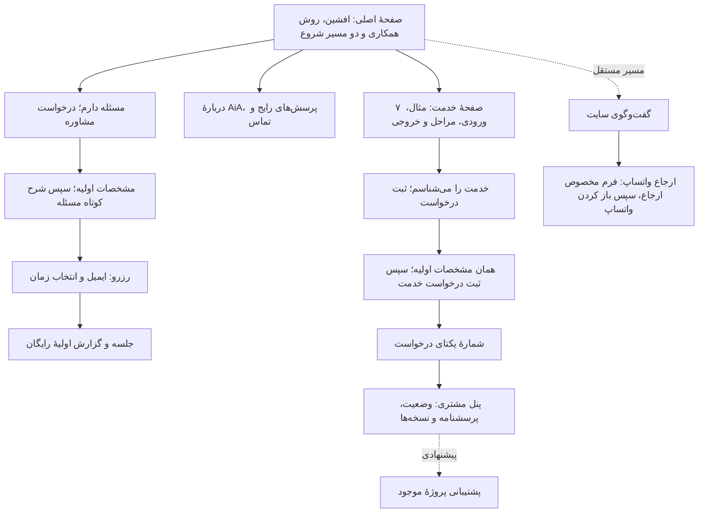

# AiA | نقشهٔ سایت و تحویل به Claude Code
تاریخ: 2026-11-16  
وضعیت: **نسخهٔ فعلی نقشه برای ادامهٔ پروژه**. این سند تأیید طرح گرافیکی نهایی، تأیید پرسشنامه‌های پیش‌نویس یا مجوز انتشار و اتصال واقعی نیست.

## از اینجا شروع کن

این سند مربوط به **وب‌سایت خود AiA**، خدمات مشاوره و ساخت راهکارهای اختصاصی افشین دبیری در دبی است. با پروژهٔ جداگانهٔ AiReception، فروشگاه AiA Shop یا فرم سفارش طراحی سایت برای مشتری اشتباه نشود. `afshindabiri/Dots` مرجع مستندات است؛ صرف وجود این سند ثابت نمی‌کند کد اجرایی سایت در همین ریپازیتوری است. قبل از تغییر کد، پوشه و ریپازیتوری اجرایی موجود را با افشین تطبیق بده. اگر مشخص نیست، فقط نقشه، متن و نمونهٔ بصری را آماده کن و ریپازیتوری اجرایی جدید یا مقصد انتشار را حدس نزن.

اول فایل‌های «مراجع» را بخوان؛ تصمیم‌های قطعی را از پیشنهاد جدا کن. بعد **صفحهٔ اصلی فارسی و یک صفحهٔ خدمت کامل برای AI Reception** را به‌عنوان اولین نمونهٔ پیشنهادی طرح بزن. برای خروجی نخست، وایرفریم دو صفحه، محتوای فارسی و نمودار خوانا در دسکتاپ و موبایل کافی است؛ فرم‌ها و چت در نمونه فقط نمایشی‌اند. قبل از تعمیم به شش خدمت دیگر، نتیجه را برای بازبینی افشین نشان بده. اگر کد تغییر می‌کند، کار پیچیده یا پرریسک را در شاخهٔ جدا و بدون تغییر برگشت‌ناپذیر روی شاخهٔ اصلی انجام بده.

## نقشهٔ فعلی

**۱. بخش عمومی:** صفحهٔ اصلی، صفحه‌های خدمات، دربارهٔ افشین/AiA، FAQ و تماس. اولویت با فارسی و RTL است. روی صفحهٔ اصلی «درخواست مشاوره رایگان» و «دیدن خدمات» از هم متمایز باشند. در پیشنهاد فعلی، دیدن شرح خدمات به فرم وابسته نیست. وب‌سایت مخاطب را برای اطلاع از راهکار مجبور به انتخاب نام فنی نمی‌کند.

**۲. شروع همکاری:** پنج فیلد مشخصات در ابتدای مسیر درخواست: نام و نام خانوادگی، حوزهٔ فعالیت، سمت، شمارهٔ تلفن، شمارهٔ واتساپ. جای دقیق شروع فرم پس از دکمهٔ درخواست، امکان «همان شماره تلفن» و استفادهٔ مجدد از اطلاعات تطبیق‌داده‌شده، جزئیات پیشنهادی‌اند. فردی که راه‌حل را نمی‌داند می‌تواند فقط مسئله‌اش را توضیح دهد؛ انتخاب خدمت برای مشاوره اجباری نیست. ایمیل و زمان را در مرحلهٔ رزرو بگیر، نه به‌عنوان دو فیلد اضافه برای همهٔ درخواست‌ها. پس از ثبت درخواست یک خدمت، شمارهٔ یکتا و مسیر پرسشنامهٔ آن خدمت در پنل را نشان بده.

**۳. پنل:** فهرست درخواست‌ها و وضعیت پروژه را از وضعیت بررسی پرسشنامه جدا نگه دار. تکمیل، مرور پیش از ارسال و ویرایش فقط در پنل. برای هر پرسشنامه یک پاسخ‌دهنده با سمت ثبت‌شده؛ مصاحبهٔ افراد دیگر، اگر لازم شد، جدا و با انتساب نقش. هر نسخه، از جمله نسخهٔ ۱، پس از مرور مشتری و بررسی جداگانهٔ AiA مرجع می‌شود؛ این پذیرش تعهد به اجرای همهٔ بندها نیست. نسخهٔ در انتظار بررسی با همان شماره قابل ویرایش است. پس از پذیرش، تغییر بعدی نسخهٔ جدید می‌سازد و تفاوت‌ها باید دیدنی باشند. نسخهٔ پذیرفته‌شدهٔ قبلی تا تأیید نسخهٔ بعدی معتبر می‌ماند. شمارهٔ درخواست برای سؤال دربارهٔ وضعیت در واتساپ قابل استفاده است؛ شماره به‌تنهایی مجوز مشاهدهٔ اطلاعات نیست. ورودی جدا برای پشتیبانی پروژه‌های موجود پیشنهادی است؛ فرم کامل پشتیبانی هنوز مصوب نیست.

### سه مسیر داده را با هم ادغام نکن

- **ثبت درخواست:** همان پنج مشخصات بالا؛ پرسشنامهٔ تخصصی بعداً در پنل.
- **رزرو مشاوره:** ایمیل برای دعوت Google Meet و زمان انتخابی. قواعد جاری در مرجع کسب‌وکار: یک ساعت زمان رزروشده، ۰۹:۰۰ تا ۲۱:۰۰ دبی (آخرین شروع ۲۰:۰۰)، فاصلهٔ حداقل ۳۰ دقیقه بین جلسات، حداقل ۳۰ دقیقه مهلت آماده‌سازی، حداکثر سه مشاورهٔ رایگان در روز. پس از رزرو، لینک جلسه ارسال می‌شود. رزرو واقعی در گام اول متصل نشود.
- **ارجاع از چت سایت به واتساپ:** تصمیم قدیمی‌تر D07 برای همین مسیر است، نه برای همهٔ بازدیدها: Bottom Sheet با نام، نام خانوادگی، واتساپ، نام کسب‌وکار، حوزه، مسئله، ایمیل، زمان مناسب تماس و تعداد کارکنان. پنج فیلد جدید به‌خودی‌خود این تصمیم را لغو نمی‌کند. اطلاعات مشترک فقط در صورت تطبیق قابل استفادهٔ مجدد است. پیش از اتصال واقعی، دربارهٔ ساده‌کردن این مسیر جداگانه تصمیم بگیر.

## خدمات و الگوی دیداری

توضیح یک‌خطی کافی نیست. برای هر خدمت یک داستان قابل‌تشخیص، متن کامل و مراحل متصل شبیه نودهای n8n بگذار. هر نود بگوید **چه ورودی می‌گیرد، چه اتفاقی می‌افتد و چه چیزی از آن بیرون می‌آید**. نمودار را به‌عنوان نمونهٔ فرایند معرفی کن، نه اینکه همهٔ راهکارها با n8n ساخته می‌شوند. موشن باید فهم داستان را بهتر کند؛ نمودار بدون حرکت و روی موبایل هم خوانا بماند. متن و مثال‌های زیر راهنمای پیش‌نویس‌اند:

1. **AI Reception:** پیام مشتری ← بررسی اطلاعات تأییدشده ← پاسخ، پیش‌نویس یا یادآوری طبق اختیار ← ثبت یا ارجاع. نمونه: «آیا در منطقهٔ من خدمات دارید؟» اگر منطقه در مرجع پوشش است و پاسخ خودکار مجاز است، پاسخ داده و نوع خدمت را برای ثبت درخواست بپرس. اگر پوشش نامعلوم است، سؤال، منطقه و اطلاعات موجود را به مسئول ارجاع بده. در حالت پیش‌نویس، ارسال با انسان است؛ در حالت یادآوری، سیستم به مشتری پاسخ نمی‌دهد. کانال و زبان پس از بررسی نیاز و امکان انتخاب می‌شوند. تلفن اختیاری است و تهیهٔ سرویس سازگار مخابراتی با مشتری است.
2. **ساخت تیم AI:** یک فرایند مشخص ← تقسیم مسئولیت بین اعضای تیم ← بازبینی نتیجه ← تحویل تیم قابل استفادهٔ مجدد. مثال: تحقیق، سناریو، بازبینی لحن؛ حدود اقدام و نقاط تأیید را کسب‌وکار تعیین می‌کند.
3. **فروش و پیگیری مشتری:** ورودی جدید ← ثبت نیاز ← تعیین مسئول و قدم بعد ← پیگیری ← ثبت نتیجه. بازگرداندن مشتری قبلی شاخهٔ جداست: سابقه ← پیشنهاد قابل اجرا ← پیام و پیگیری مجاز. رضایت برای پیام واتساپ بررسی شود؛ سود یا فروش تضمین نشود.
4. **بهینه‌سازی فرایند:** روش واقعی فعلی ← کشف منشأ تأخیر یا دوباره‌کاری ← طراحی مسیر بهتر ← اجرای بخش توافق‌شده. اگر تغییر روش یا اتوماسیون ساده کافی است، AI اجباری نیست.
5. **وب‌سایت و ابزار تحت وب:** کار موردنیاز کاربر ← طراحی مسیر و صفحه‌ها ← ساخت و آزمون ← تحویل. وب‌سایت، وب‌اپ و PWA یک خدمت‌اند؛ مشتری نوع فنی را از ابتدا انتخاب نمی‌کند.
6. **تولید مستقیم محتوا توسط AiA:** هدف و مواد اولیه ← تأیید متن/سناریو ← تولید توسط AiA ← بازبینی خروجی و تحویل. مشتری فایل نهایی می‌گیرد، نه یک تیم AI. تأیید پیش از تولید و قبل از انتشار را جدا نشان بده.
7. **آماده‌سازی دانش کسب‌وکار:** منابعی که مشتری مجاز می‌کند ← دسته‌بندی و پیگیری اطلاعات ناقص ← تأیید ← مرجع قابل استفاده. اگر سرویس وابسته به دانش است و مرجع آماده نیست، ابتدا دانش و سپس سرویس ساخته می‌شود؛ برای سرویس مستقل، نبود دانش به‌خودی‌خود پروژهٔ ساخت پایگاه ایجاد نمی‌کند.

## قواعد محتوا و مرز نسخهٔ اول

- منطق تجاری: ابتدا خواسته و روش فعلی کار، سپس امکان اجرا. گزارش اولیهٔ رایگان بعد از جلسه، مسئله، مسیر پیشنهادی، ابزارهای احتمالی و برآورد اولیهٔ هزینهٔ ساخت و هزینه‌های جاری را پوشش می‌دهد. تحلیل/طراحی تفصیلی بعد از پرداخت اولیه است. قیمت ثابت یا هزینهٔ شروع در صفحهٔ عمومی نگویید؛ وضعیت ممیزی جداگانه قطعی نیست.
- پرسشنامه‌ها برای شناخت اولیه‌اند نه مشخصات فنی کامل؛ کوتاه، تخصصی و شاخه‌ای. فرم‌های مصوب: تیم AI، طراحی وب، بهینه‌سازی فرایند. فرم‌های AI Reception، فروش، محتوا، دانش و پشتیبانی پیش‌نویس‌اند؛ اصلاح‌های محدود مصوب به معنی تصویب کل فرم نیست.
- نسخهٔ اول پیشنهادی: صفحهٔ اصلی و یک نمونهٔ کامل AI Reception با دادهٔ فرضی و دو شاخهٔ پاسخ/ارجاع. در صورت نمایش فرم، مسیر نمونه و بدون جمع‌آوری واقعی باشد. دامنه، طراحی نهایی، لوگو، نمونه‌کار قابل انتشار، احراز هویت، ذخیرهٔ اطلاعات، بک‌اند چت و ارسال دعوت یا پیام را قبل از تعهد یا انتشار جداگانه بررسی کن. پیش‌نمایش را به‌جای سایت زنده معرفی نکن.
- برای طرح از راهنمای UI/UX Pro Max و Taste در صورت دسترسی استفاده کن؛ نبود یا نحوهٔ نصب را بدون بررسی ادعا نکن. طرح ردشدهٔ قبلی را نسخهٔ نهایی فرض نکن. RTL، خوانایی موبایل، صفحه‌کلید، لینک و دکمه‌های مسیر اصلی و ترجیح کاهش حرکت را در بازبینی نمونه بررسی کن.

## مراجع داخل Dots

- [وضعیت و تصمیم‌های وب‌سایت](current.md) · [شرح تصمیم‌های وب‌سایت، از جمله D07](details.md)
- [وضعیت کسب‌وکار و حدود همکاری](../aia-business/current.md) · [تعریف خدمات](../aia-business/service-decisions-sources-2026-11-05.md)
- [نقطهٔ ادامه و فهرست فرم‌های مصوب/پیش‌نویس](../aia-business/questionnaire-checkpoint-2026-11-14.md) · [قواعد مصوب فرم و پنل](../aia-business/approved-questionnaire-client-portal-decisions-2026-11-07.md)
- مرجع تاریخ‌دار این نسخه: نمودار نقشهٔ سایت ارسال‌شده در گفت‌وگوی AiA در ۱۶ نوامبر و اصلاح قبلی افشین دربارهٔ شرح بصری خدمات و پنج فیلد اولیه.

## پیام آماده برای Claude Code

> فایل `topics/aia-website/CLAUDE-CODE-HANDOFF-2026-11-16.md` و مراجعش را در `afshindabiri/Dots` بخوان. Dots مرجع مستندات است. اول محل کد سایت را مشخص کن و اگر پیدا نشد، دربارهٔ مخزن اجرایی سؤال کن. برای گام اول، نقشه را به وایرفریم فارسیِ صفحهٔ اصلی و صفحهٔ AI Reception تبدیل کن. در نمونهٔ Reception مسیر یک پیام مشتری را تا پاسخ مجاز یا ارجاع انسانی با نودهای خوانا نشان بده. متن و طرح و حدود نسخهٔ اول را برای بازبینی بیاور؛ هنوز سرویس واقعی، انتشار یا اتصال داده انجام نده.
